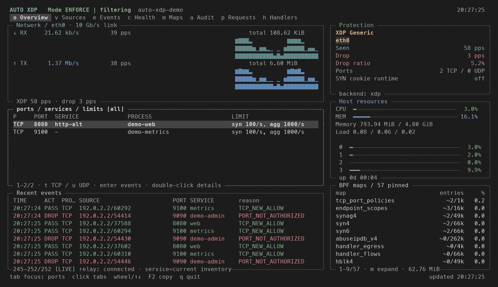
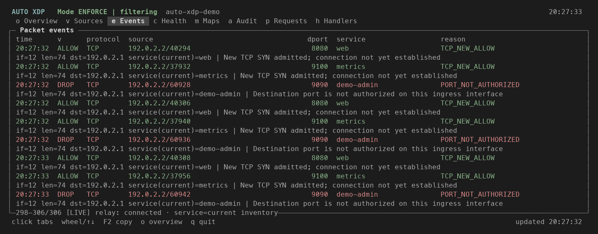
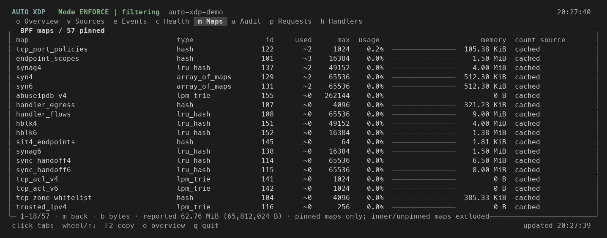
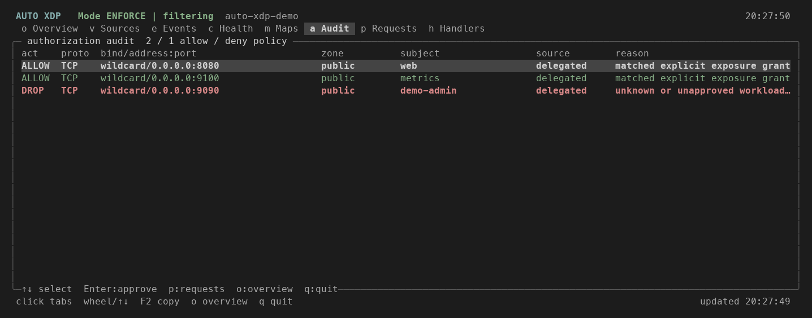
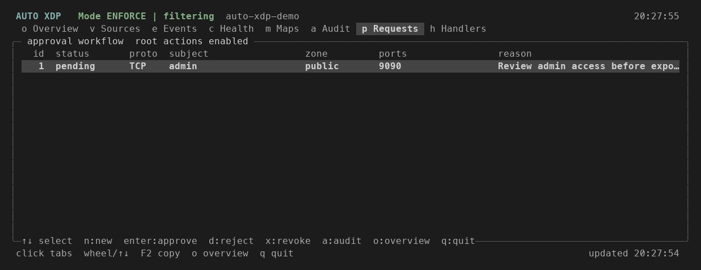
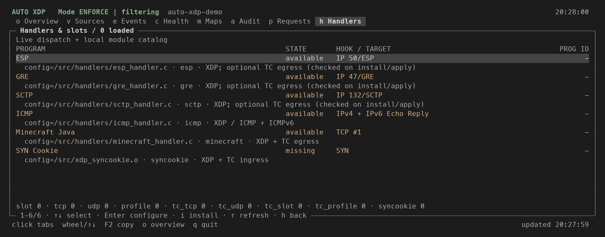
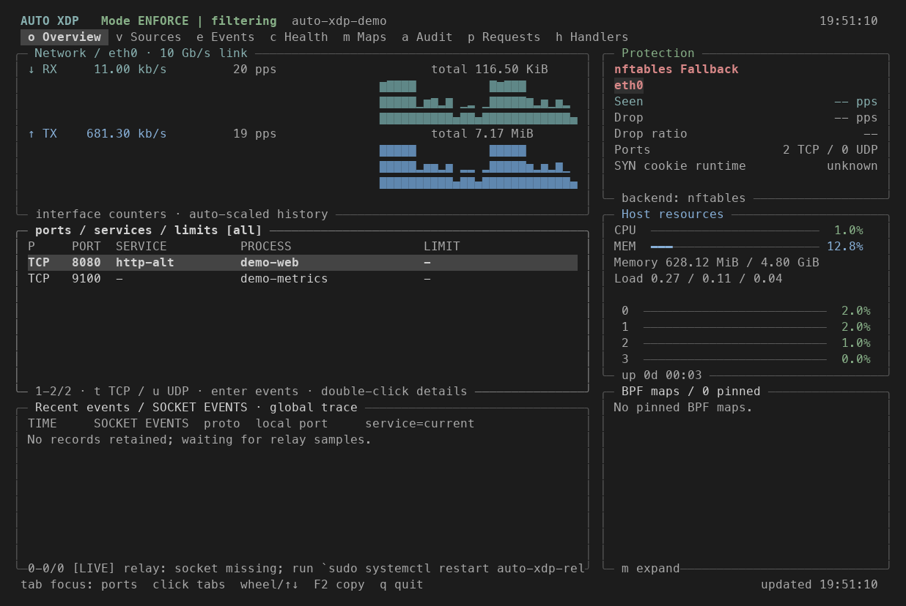

<p align="center">
  <picture>
    <source media="(prefers-color-scheme: dark)" srcset="svg/Auto_XDP_logo_white.svg">
    <source media="(prefers-color-scheme: light)" srcset="svg/Auto_XDP_logo_smooth.svg">
    
  </picture>
</p>

<h1 align="center">Auto XDP</h1>

<p align="center">
  <strong>A service-aware firewall for Linux</strong>
</p>

<p align="center">
  Approve the services you want to expose.<br>
  Auto XDP keeps incoming access in sync as they start and stop.
</p>

<p align="center">
  <a href="https://axdp.dev/"><strong>Website</strong></a> ·
  <a href="#installation"><strong>Install</strong></a> ·
  <a href="#first-run">First run</a> ·
  <a href="#more-screenshots">Screenshots</a> ·
  <a href="https://github.com/Kookiejarz/Auto_XDP/wiki">Wiki</a>
</p>

<p align="center">
  <a href="https://github.com/Kookiejarz/Auto_XDP/releases/latest"></a>
  <a href="https://github.com/Kookiejarz/Auto_XDP/actions/workflows/distro-check.yml"></a>
  <a href="LICENSE"></a>
</p>

<p align="center">
  <a href="https://github.com/Kookiejarz/Auto_XDP/wiki/Installation-and-Upgrade#requirements"></a>
  <a href="https://ebpf.io/"></a>
  <a href="https://github.com/Kookiejarz/Auto_XDP/wiki/Installation-and-Upgrade#requirements"></a>
  <a href="https://github.com/Kookiejarz/Auto_XDP/wiki/Installation-and-Upgrade#requirements"></a>
</p>

<p align="center">
  <a href="https://github.com/Kookiejarz/Auto_XDP/wiki/Installation-and-Upgrade#requirements"></a>
  <a href="https://github.com/Kookiejarz/Auto_XDP/wiki/Installation-and-Upgrade#requirements"></a>
  <a href="https://github.com/Kookiejarz/Auto_XDP/wiki/Installation-and-Upgrade#requirements"></a>
  <a href="https://github.com/Kookiejarz/Auto_XDP/wiki/Installation-and-Upgrade#requirements"></a>
  <a href="https://github.com/Kookiejarz/Auto_XDP/wiki/Installation-and-Upgrade#requirements"></a>
</p>

<br>

[](assets/readme/xdp-overview.png)

**XDP Generic** on isolated Linux, captured November 8, 2026.
Real HTTP requests reach approved ports 8080 and 9100; unapproved port 9090 is
blocked.

## Why Auto XDP?

Manually maintained port rules can become outdated as services start, stop or
change. Auto XDP matches your approvals to live listeners and keeps active
allow rules current, reducing repetitive firewall maintenance.

- **Keep rules aligned with services.** Approve access once; active allow rules
  follow the service's listeners.
- **Drop unwanted traffic early.** Native XDP filters packets before the normal
  Linux networking path on supported hosts.
- **See what is allowed and why.** Inspect service approvals, traffic counters,
  and packet decisions in the CLI or live dashboard.

For example, approve `nginx.service` for public HTTPS on TCP `443`. With
enforcement enabled:

| What happens on the host | What Auto XDP does |
|---|---|
| Nginx starts listening on port 443 | Adds an allow rule for incoming connections to that listener |
| Nginx stops and its listener disappears | Removes that allow rule |
| Nginx starts listening again | Restores the rule when the listener matches your approval |
| An unapproved app starts listening on port 8080 | Keeps incoming connections to that app blocked |

Discovering a listening port does **not** authorize it. Rules update after
service changes are detected and reconciled; updates are not instantaneous.
Other host firewalls and cloud security groups still apply.

XDP is used when supported, with nftables fallback when permitted. Services
requiring XDP-specific protection stay closed when it is unavailable.
See [how it works and how it compares](https://github.com/Kookiejarz/Auto_XDP/wiki#how-it-works).

## Installation

Requires Linux, Python 3.10+, and `sudo`. The installer checks kernel capabilities
and installs the required dependencies. See the Wiki for
[supported systems and full requirements](https://github.com/Kookiejarz/Auto_XDP/wiki/Installation-and-Upgrade#requirements).

Install the latest published release:

```bash
(
  set -e
  # quick-install-version:start
  AUTO_XDP_VERSION=v26.11.12a
  # quick-install-version:end
  auto_xdp_tmp=$(mktemp -d)
  trap 'rm -rf "$auto_xdp_tmp"' EXIT
  curl --proto '=https' --proto-redir '=https' --tlsv1.2 -sSfL \
    "https://github.com/Kookiejarz/Auto_XDP/archive/refs/tags/${AUTO_XDP_VERSION}.tar.gz" \
    | tar -xz -C "$auto_xdp_tmp" --strip-components=1
  cd "$auto_xdp_tmp"
  sudo bash setup_xdp.sh
)
```

For [source installation, interface selection, and upgrades](https://github.com/Kookiejarz/Auto_XDP/wiki/Installation-and-Upgrade),
see the installation guide.

## First run

Fresh installs remain audit-only until explicitly enabled. Start by discovering
services on the host:

```bash
sudo axdp discover
```

Approve the services you want to make reachable. On a remote host, approve SSH
first. These examples assume `ssh.service` listens on port 22 and
`nginx.service` is already configured to serve HTTPS on port 443; use the actual
service names and ports reported on your host (for example, `sshd.service`):

```bash
sudo axdp allow ssh.service tcp/22 --zone public
sudo axdp allow nginx.service tcp/443 --zone public
```

These commands record approvals; they do not install, configure, or start the
services. Review the resulting decisions, then enable enforcement:

```bash
sudo xdp-port-sync --mode audit --explain
sudo axdp enable
```

Auto XDP now synchronizes allow rules for approved listeners as they appear and
disappear. You can check the effective policy with `sudo axdp ports` and open
the live dashboard with `sudo axdp tui`.

## More screenshots

More views from the XDP session, plus a separate nftables fallback example.
Click any preview to open the full-size image.

<table>
  <tr>
    <td width="50%" valign="top">
      <strong>Events · packet decisions</strong><br>
      <a href="assets/readme/xdp-events.png"></a>
      <br><sub>Recorded packet samples with allow/drop reasons.</sub>
    </td>
    <td width="50%" valign="top">
      <strong>BPF Maps · live firewall state</strong><br>
      <a href="assets/readme/xdp-maps.png"></a>
      <br><sub>Pinned maps, entry counts, and reported memory.</sub>
    </td>
  </tr>
  <tr>
    <td width="50%" valign="top">
      <strong>Audit · service authorization</strong><br>
      <a href="assets/readme/xdp-audit.png"></a>
      <br><sub>Approved web and metrics services; admin access denied.</sub>
    </td>
    <td width="50%" valign="top">
      <strong>Requests · review before approval</strong><br>
      <a href="assets/readme/xdp-requests.png"></a>
      <br><sub>The admin listener stays blocked while approval is pending.</sub>
    </td>
  </tr>
  <tr>
    <td width="50%" valign="top">
      <strong>Handlers · optional protection</strong><br>
      <a href="assets/readme/xdp-handlers.png"></a>
      <br><sub>Module availability; optional handlers are not enabled here.</sub>
    </td>
    <td width="50%" valign="top">
      <strong>nftables · fallback example</strong><br>
      <a href="assets/readme/linux-overview.png"></a>
      <br><sub>A separate same-day Linux test using the fallback backend.</sub>
    </td>
  </tr>
</table>

Images are rendered from real terminal captures in an isolated Linux test
environment. They show functional behavior, not a throughput benchmark.

## Documentation

- [Installation, upgrades, and recovery](https://github.com/Kookiejarz/Auto_XDP/wiki/Installation-and-Upgrade)
- [Common commands](https://github.com/Kookiejarz/Auto_XDP/wiki/Common-Commands)
- [Policy, compatibility, and protection details](https://github.com/Kookiejarz/Auto_XDP/wiki/Compatibility-and-Protection-Details)
- [Dashboard and telemetry](https://github.com/Kookiejarz/Auto_XDP/wiki/Monitoring-and-Telemetry)
- [All Wiki guides](https://github.com/Kookiejarz/Auto_XDP/wiki)

## Contributing

See [CONTRIBUTING.md](./CONTRIBUTING.md) for contribution guidelines and local test commands.

## License

[MPL 2.0](./LICENSE) © 2026 Yunheng Liu
